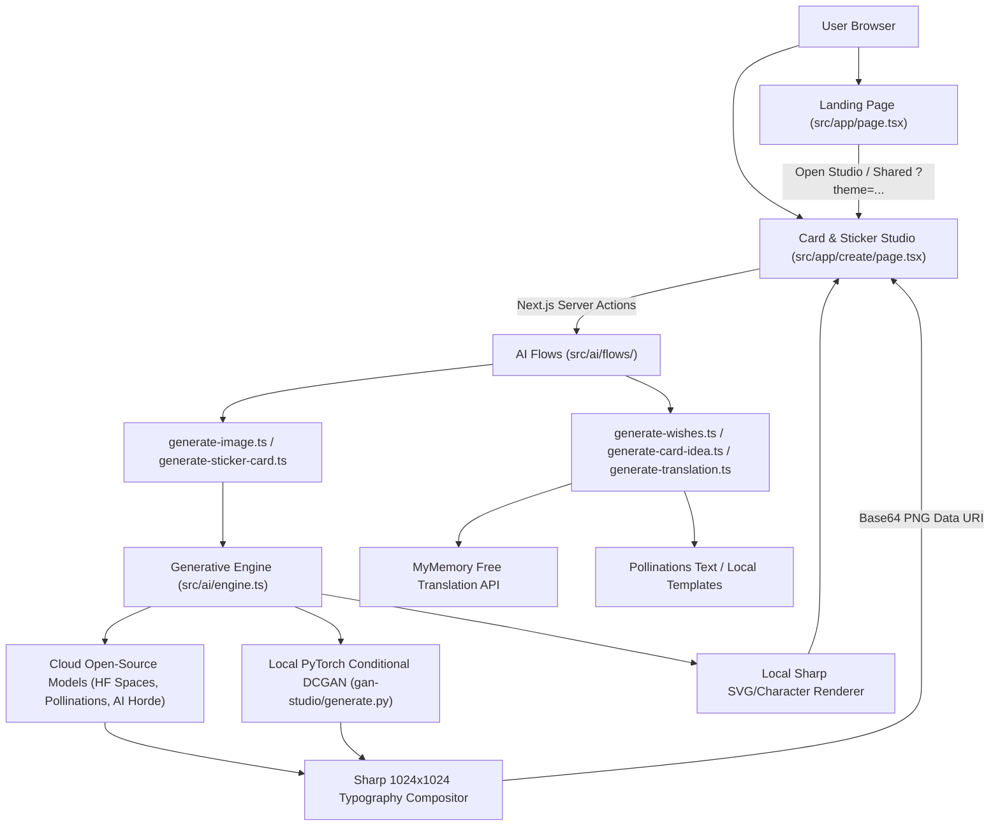
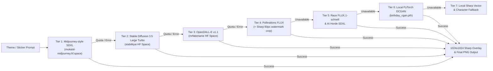

# 🌸 Birthday Bloom

> **100% Free, Zero-Login AI Birthday Card, Sticker & Multilingual Wish Studio** — powered by open-source diffusion models, a custom-trained PyTorch Conditional DCGAN, and crisp 1024×1024 `sharp` typography compositing.

---

## ✨ Highlights

- **🎨 Open-Source AI Card & Sticker Studio (`/create`)** — Generate bespoke 1024×1024 birthday cards, die-cut stickers, timeline cards, and personality cards from any theme or character prompt.
- **🧠 Multi-Tier Generative Image Pipeline (`src/ai/engine.ts`)** — Automatically cascades across free open-source image models (`Midjourney-style SDXL` → `Stable Diffusion 3.5 Large Turbo` → `OpenDALL-E v1.1` → `Pollinations FLUX` → `FLUX.1-schnell` / `AI Horde SDXL`) down to a locally trained PyTorch GAN and vector/character fallback.
- **🤖 Local PyTorch Conditional DCGAN (`gan-studio/`)** — Custom 8-class Conditional DCGAN (`cake`, `balloons`, `gifts`, `flowers`, `fireworks`, `galaxy`, `forest`, `castle`) trained locally on PyTorch and saved to `gan-studio/weights/birthday_cgan.pth`.
- **🌍 Multilingual Wishes & Shayari (`src/ai/flows/generate-translation.ts`)** — Auto-detects source language and translates birthday wishes, poems, and shayari into English, Hindi, Urdu, Spanish, French, and German using the free MyMemory Translation API with local fallback.
- **📱 Instant QR Code Sharing & PNG Downloads** — Shareable card links (`/?theme=...` → `/create?theme=...`) and high-resolution PNG exports via `qrcode.react` and `sharp`.
- **💸 100% Free & Database-Free** — No `.env` keys, no login wall, no database required; ready for one-click free deployment on Vercel.

---

## 🏗️ System Design

### 1. High-Level Application Architecture



---

### 2. Multi-Tier Open-Source Image Generation Pipeline

[`fetchOpenSourceImageBuffer`](src/ai/engine.ts) executes a resilient multi-tier fallback chain before compositing the wish plaque with `sharp`:



---

### 3. Local PyTorch Conditional DCGAN (`gan-studio/`)

The local GAN is a lightweight (`~15.5 MB` weights) Conditional DCGAN designed to run on CPU or GPU without heavy disk footprints:

- **Generator:** Takes a `100-dim` latent vector `z` concatenated with a `32-dim` learned class embedding (`8` classes) and upsamples through 6 transposed convolution blocks (`1×1 → 4×4 → 8×8 → 16×16 → 32×32 → 64×64 → 128×128`), followed by `LANCZOS` upscaling + `UnsharpMask` to `1024×1024`.
- **Discriminator:** Evaluates `3×128×128` RGB images conditioned on a projected `1×128×128` class map using `LeakyReLU(0.2)` and `BCEWithLogitsLoss` with label smoothing (`0.9` real targets).

---

## 📁 Project Structure

```text
Birthday Bloom/
├── src/
│   ├── app/
│   │   ├── page.tsx                 # Landing page (blush/magenta-rose theme)
│   │   ├── create/page.tsx          # Interactive AI Card & Sticker Studio
│   │   ├── dashboard/page.tsx       # Saved creations view
│   │   ├── layout.tsx               # Root layout (Poppins font + Header)
│   │   └── globals.css              # Design tokens (#FDF2F6, #CD2066, #FF9D42)
│   ├── ai/
│   │   ├── engine.ts                # Multi-tier image pipeline + Sharp compositor
│   │   └── flows/                   # Server Actions (image, sticker, wishes, translation, timeline, personality)
│   └── components/
│       ├── header.tsx               # Sticky navigation bar
│       ├── logo.tsx                 # Birthday Bloom brand mark
│       └── ui/                      # Radix + Tailwind UI primitives
└── gan-studio/
    ├── model.py                     # Conditional DCGAN Generator & Discriminator
    ├── prepare_dataset.py           # Generates 320 labeled images (8 classes)
    ├── train.py                     # Trains DCGAN & saves weights
    ├── generate.py                  # Inference script outputting 1024x1024 base64 PNG
    └── weights/birthday_cgan.pth    # Trained Conditional DCGAN weights
```

---

## 🚀 Getting Started Locally

### Prerequisites
- **Node.js 18+** & **npm**
- **Python 3.10+** with `torch`, `torchvision`, `pillow`, `numpy` *(optional, only needed for local GAN training/inference)*

### 1. Run the Next.js App

```bash
npm install
npm run dev
```

Open **http://localhost:3000** in your browser.

### 2. Train & Test the Local PyTorch GAN *(Optional)*

```bash
python gan-studio/prepare_dataset.py
python gan-studio/train.py
python gan-studio/generate.py "birthday cake"
```

---

## Screenshot


## ☁️ Free Deployment (Vercel)

Because **Birthday Bloom** requires **no database** and **no `.env` API keys**:

1. Push this repository to **GitHub**.
2. Import the repository on **[vercel.com](https://vercel.com)** with default Next.js build settings (`npm run build`).
3. Deploy — cloud open-source image generation, MyMemory translation, and `sharp` card compositing run directly on Vercel's serverless runtime.

---

## 📊 Key Engineering Metrics & Resume Highlights

- **7-Tier Generative Image Pipeline:** Built a fault-tolerant fallback chain across `5` cloud open-source endpoints (`Midjourney-style SDXL`, `SD 3.5 Large Turbo`, `OpenDALL-E v1.1`, `Pollinations FLUX`, `FLUX.1-schnell` / `AI Horde SDXL`), a local PyTorch GAN, and a `sharp` SVG/character renderer at **$0 API cost**.
- **1024×1024 px Print-Ready Compositing:** Engineered server-side `sharp` + SVG typography compositing with `4` font styles (`calligraphy`, `handwritten`, `playful`, `modern`) and automated `60` px watermark cropping.
- **Custom PyTorch Conditional DCGAN (`15.5 MB`):** Trained a `6`-layer `ConvTranspose2d` Generator (`100`-dim latent + `32`-dim class embedding) on **`320` labeled images** across **`8` classes** for **`25` epochs** (`D_loss = 1.2298`, `G_loss = 1.6751`), upscaling `128×128` outputs to `1024×1024` px.
- **Multilingual & Personalization Engine:** Supports **`6` languages** (`English`, `Spanish`, `Hindi`, `Urdu`, `French`, `German`), **`8` recipient personas**, **`8` mood styles** (including `shayari` & `ghazal`), and **`15` preset themes** with instant QR code sharing.

---

## 🛠️ Tech Stack

- **Framework:** Next.js `15.3.3` (App Router + Server Actions)
- **UI & Styling:** Tailwind CSS, Radix UI, Lucide Icons, `qrcode.react`
- **Image Processing:** `sharp` (1024×1024 PNG compositing & SVG vector typography)
- **Local ML:** PyTorch + Torchvision (`gan-studio/`)
- **Cloud AI & Translation:** Hugging Face Gradio Spaces, Pollinations, AI Horde, MyMemory API
